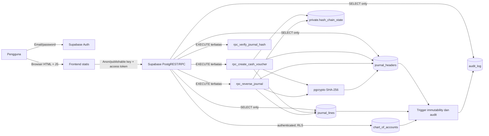
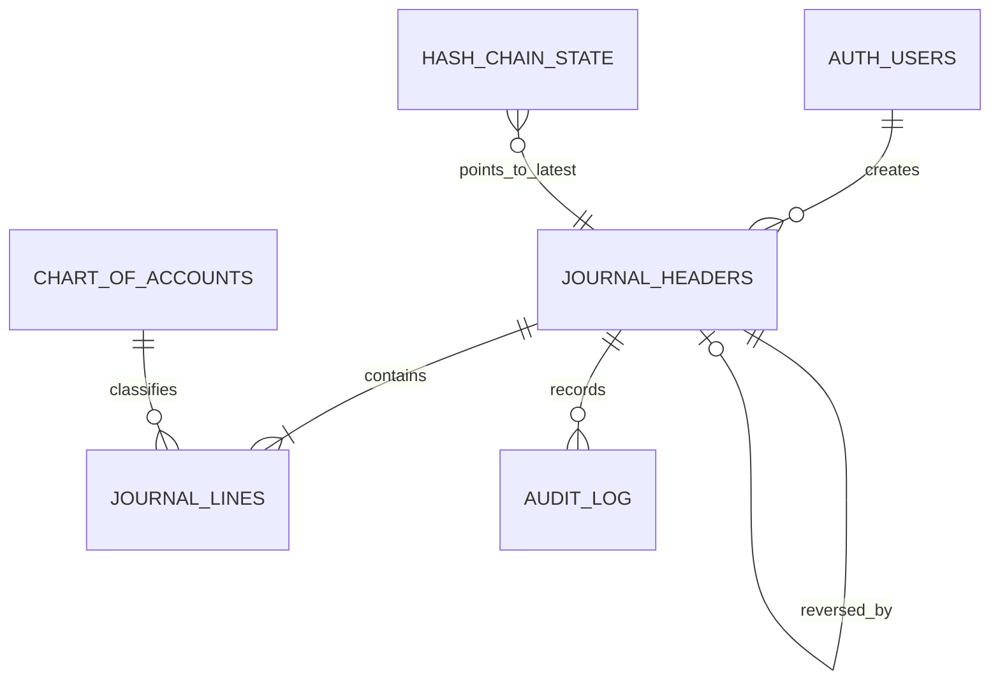

# Arsitektur dan kontrol Soal 3.2

## Alur posting

1. Browser memakai Supabase Auth dan memanggil `rpc_create_cash_voucher` dengan tanggal, nomor, deskripsi, klasifikasi, dan baris jurnal.
2. Function `SECURITY DEFINER` memvalidasi `auth.uid()`, tanggal Jakarta, akun aktif, debit/kredit, saldo, dan akun kas di sisi kredit.
3. Dalam satu transaksi PostgreSQL, function mengunci row tunggal `private.hash_chain_state`, mengambil sequence/hash sebelumnya, membuat header DRAFT dan baris, menghitung SHA-256 dari JSONB deterministik, mengubah header menjadi POSTED, dan memajukan rantai.
4. Constraint unik mencegah nomor voucher duplikat. Jika salah satu operasi gagal, seluruh transaksi rollback.
5. Trigger mencatat perubahan header, detail, dan chart akun ke `audit_log`. Data jurnal POSTED ditolak untuk update/delete; direct DML role klien tidak diberikan.

## Storno dan pemeriksaan integritas

`rpc_reverse_journal` mengunci header sumber, mengharuskan status POSTED dan alasan, lalu membuat journal type REVERSAL dengan `debit`/`credit` terbalik, `reversal_of` unik, serta hash/urutan baru. Jurnal asal tidak diperbarui. Kunci row asal dan UNIQUE `reversal_of` menghalangi reversal ganda dalam perlombaan transaksi.

`rpc_verify_journal_hash` membangun ulang payload menggunakan urutan line_no deterministik dan metadata persisted, lalu membandingkan SHA-256 serta predecessor sequence/hash.

## Entitas utama

## Keamanan dan keterbatasan

- Frontend berisi placeholder URL dan anon/publishable key; tidak berisi service role key. Role `authenticated` mendapatkan SELECT tabel/policy RLS dan EXECUTE hanya pada tiga RPC. `anon` tidak mendapat hak tersebut; tabel tidak memberi grant INSERT/UPDATE/DELETE/TRUNCATE kepada role klien.
- Fungsi sensitif menggunakan `SECURITY DEFINER`, `search_path=''`, nama objek schema-qualified, dan `auth.uid()`; nilai `created_by` tidak diterima dari browser.
- Semua pengguna authenticated saat ini dapat membaca seluruh jurnal dan audit log untuk aplikasi tugas satu organisasi. Produksi multi-tenant memerlukan tenant ID, policy pemisahan data, serta otorisasi reversal yang lebih rinci.
- Audit log dan hash/checksum memberi deteksi/perlindungan terhadap perubahan melalui jalur aplikasi, bukan jaminan tahan administrator. Database owner/superuser dapat menonaktifkan trigger, mengubah data/schema, atau membangun ulang rantai. Terapkan kontrol admin, log eksternal/backup, dan pemisahan tugas.
- Migration diasumsikan untuk project Supabase baru dan belum dijalankan. Versi PostgreSQL, privilege aktual, ekstensi `pgcrypto`, konfigurasi Auth, dan API schema cache harus diperiksa pada project target sebelum klaim integrasi.
